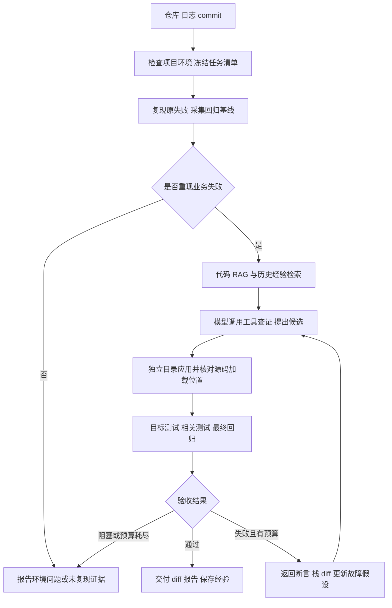

# CI 修复 Agent 真实项目接入与进阶实施计划

更新于 2026 年 11 月 18 日。

每个阶段的新增文件、修改接口、开发顺序和验收任务，见 [分阶段文件与实现清单](STAGE_IMPLEMENTATION_PLAN.md)。

目标用户是有现有 Python 项目、pytest 测试和 CI 失败记录的开发者。用户提供仓库路径、日志和失败版本，Agent 复现问题、探索源码、提出补丁、执行验收并交付证据。技术主线是**陌生仓库里的故障定位、测试反馈驱动的修复，以及可恢复的执行过程**。

首个可用发布版以多个真实 Python 仓库为验收范围。每个仓库采用明确的环境与测试配置。开发者可以接入自己的仓库，通过环境检查确认运行条件。本文中“目标”和待办框表示后续能力，当前已完成的部分单独列明。

## 1 当前实现和具体缺口

本次复跑现有测试，结果为 5 项通过。它们覆盖 pytest 子进程结果、worktree 补丁筛选、两个示例仓库、进程间恢复，以及用脚本模型检查 Function Calling 的工具结果回传。

| 能力 | 当前实现 | 后续需要解决的问题 |
| --- | --- | --- |
| CLI | `fix`、`status`、`resume`，可传日志、commit、解释器、测试选择器和手工补丁 | 接入配置与环境诊断 |
| pytest | hook 收集 setup、call、teardown，区分失败、跳过、收集错误、超时 | 完整收集清单、环境归因和不稳定失败处理 |
| 工具调用 | LangChain 绑定读取、字面搜索和 Git diff | 文件树、函数索引、跨文件上下文选择 |
| 修复循环 | LangGraph 编排，batch 和 sequential 两种策略 | 完整的回归失败反馈、模型选择后续行动、统一预算和候选去重 |
| 验收 | 相同基线的独立 worktree，原目标通过且基线已通过用例保持通过 | 确认测试加载候选源码、保存实际检查范围 |
| 恢复 | SQLite checkpoint、任务锁、候选验证后恢复 | 模型内部多次工具调用的细粒度 checkpoint |
| 记忆 | 同一仓库内关键词重合检索，取前三条经验 | 来源、失效、稳定 repo_id、检索有效性 |
| 评测 | 20 个合成案例，来自 5 类故障各 4 个数值版本，含隐藏测试 | 真实历史 Bug、真实模型修复率与模块对照实验 |
| CI | 测试与修复演示工作流 | GitHub 远端实跑记录与跨 runner 状态复用 |

本次环境未发现已配置的 Gemini 密钥和模型标识，真实模型效果仍待验证。此前 20 个离线参考补丁通过，证明了验收路径，真实修复率需要另行测量。

本次复现了一项执行风险。候选目录采用 `src/sample_shipping/` 布局且已修正门槛条件，但解释器继承的 `PYTHONPATH` 指向原源码。现有运行器继续执行原实现。后续须核对实际导入路径，并为候选建立匹配的执行环境。

代码审查确认的其他缺口如下。

- `workflow.py` 当前只反馈目标测试输出。引入回归时，模型拿到用例名，拿不到该用例的完整失败断言和栈。
- 原 CI 日志主要用于提取目标用例和版本，尚未作为独立原始产物保存。
- 测试输出先在内存中完整捕获再截断。长日志落盘、测试派生进程超时清理需要补齐。
- SQLite 经验表在首次成功写入时创建，需要处理空库、迁移和初始化中断。
- 候选按列表序号标识，模型返回的证据位置尚缺程序核验。
- 单个 `generate` 节点内有多轮模型调用，节点中断可能重新花费这些调用。

## 2 发布版怎么使用

现有 CLI 已支持以下基本命令。

```powershell
ci-repair fix --repo D:\checkout-service --log .\ci-error.log --commit <失败SHA>
ci-repair fix --repo D:\checkout-service --test tests/test_checkout.py::test_coupon --python <目标解释器>
ci-repair status <task_id>
ci-repair resume <task_id>
```

目标新增 `doctor` 命令，显示实际解释器、依赖、源码加载位置、pytest 配置和测试计划。拟增加 `.ci-repair.toml`，声明工作子目录、源码路径、运行环境、测试参数与回归范围。命令行参数优先，推断结果写入本次运行清单。

每个任务交付 `manifest.json`、`events.jsonl`、原日志与测试产物、候选 diff、`report.json` 和可直接审查的 `report.md`。验收通过时另存 `fix.diff`。报告区分原目标已修复、已完成的回归范围、仍存在的基线失败，以及独立评测结果。

发布目标是接入至少 3 个真实 Python 仓库，覆盖平铺包、`src/` 包和多包或子目录布局。每个仓库至少完成一例真实模型生成、应用和验收的修复。另完成一次 GitHub Actions 远端运行和一次真实任务恢复。仓库环境配置将成为支持范围的一部分。

## 3 一次完整修复的执行路径



例如，结算测试发现优惠券使用后应付金额偏高。系统冻结失败 SHA，重跑原用例并保存回归基线。检索返回结算、优惠计算、运费函数，模型再通过工具核查源码和测试。

第一个候选可能直接为达到门槛的订单免运费。它通过目标测试，却破坏了偏远地区规则。验收器保存该失败的断言、栈、候选 diff 和测试状态，反馈给模型。模型重新检查调用参数，第二个候选让运费按优惠前金额计算，同时保留地区分支。它从原基线重新应用，完成相同验收后交付。

这个过程的每次决策都可以回答三个问题：看到了什么证据、采取了什么动作、实际执行结果是什么。

## 4 框架与自研模块怎么分工

| 组成 | 提供什么 | 需要自己实现什么 |
| --- | --- | --- |
| LangChain | 模型接口、工具绑定、结构化输出 | 工具校验、证据格式、上下文选择、响应错误与预算处理 |
| LangGraph | 状态流转、条件边、checkpoint | 业务状态、停止规则、可重试节点、恢复后的动作 |
| pytest | 执行开发者测试，返回事件 | 日志解析、基线对照、实际执行清单、补丁接受条件 |
| Git worktree | 同一提交的多个代码副本 | 候选生命周期、diff 检查、恢复和残留回收 |
| SQLite | 保存任务与经验，目标增加 FTS5 检索 | schema 迁移、repo_id、经验失效、检索排序 |

模型负责提出定位动作和修复假设。执行器负责真实读文件、应用修改、跑测试。验收器依据测试证据决定候选是否满足当前检查。

## 5 数据结构与产物关联

目标定义带版本号的数据结构，保留现有 CLI 入口。

| 结构 | 关键字段 | 用途 |
| --- | --- | --- |
| `ProjectProfile` | repo_id、commit、cwd、解释器、源码路径、测试参数、依赖指纹 | 复现本次运行条件 |
| `FailureEvidence` | node_id、阶段、异常、断言、traceback、原始产物位置 | 描述失败，支持核查 |
| `CodeChunk` | repo_id、commit、path、symbol、行号、内容 hash、imports | 固定版本的检索单元 |
| `Candidate` | candidate_id、base_commit、diff_hash、hypothesis、evidence_ids、parent_id | 标识候选与反馈来源 |
| `TestRun` | run_id、candidate_id、命令、环境、收集与执行用例、状态、退出码、耗时 | 实际执行证据 |
| `ValidationResult` | 目标是否修复、新回归、缺失用例、验收范围、原因、test_run_ids | 接受或淘汰候选 |
| `RepairExperience` | memory_id、repo_id、来源任务、commit、特征、验收范围、证据链接、验证时间 | 可检索的历史经验 |

目标统一状态为 `created`、`checking`、`reproducing`、`investigating`、`patching`、`validating`、`paused`、`accepted`、`rejected`、`blocked`、`budget_exhausted`。运行异常、所在步骤和可恢复性单独记录。状态变更落事件文件，报告和恢复读取同一份证据。

## 6 执行与验收如何可靠

优先确认测试加载候选源码。环境检查读取项目结构、pytest 配置和关键依赖，显示实际 import 来源。平铺布局、`src/`、editable install 和子目录布局各有接入案例。需要独立环境时在候选目录安装目标项目并固定依赖；编译扩展与外部服务通过项目配置声明。基线和候选使用相同环境条件，报告保存其指纹。

测试按三层执行。原目标用于快速判断修复方向。修改文件与显式引用或覆盖记录选出的相关测试用于尽早发现回归。交付前跑配置中声明的最终回归范围。报告列明每层实际运行的检查和没有完成的检查。

验收比较基线与候选的用例集合和逐项状态。目标必须执行并通过，基线已通过的回归用例必须继续通过。收集数量减少、跳过、执行异常和检查未完成都生成明确原因。基线已有的其他失败保留。对重复运行结果变化的用例保存次数和状态，结论限定为本次观察结果。

执行器持续写日志，内存保留有界摘要。超时后终止对应子进程树，保存已取得的输出。清理错误独立记录，避免覆盖最早的修复失败。worktree 提供代码副本隔离，容器执行器如被启用，镜像与环境参数也进入运行清单。

pytest 的导入模式与 `sys.path` 会影响实际源码来源，接入检查需显式核实。参考 [pytest 导入机制](https://docs.pytest.org/en/stable/explanation/pythonpath.html)。

## 7 代码 RAG 如何实现

检索对象是失败提交中的源码，结果带路径、行号和符号。先用 AST 按函数、方法、类、模块级代码切分，保留 decorators、imports 和父符号。长函数按语句块继续拆分。解析失败时回退到带行号文本分块，并记录降级原因。参考 [Python AST](https://docs.python.org/3.12/library/ast.html)。

第一版采用精确符号查询与 BM25。SQLite FTS5 处理错误、测试名和自然语言查询；标识符按下划线和驼峰拆分，同时保留原始名称。再依据显式 imports 和可解析引用扩展调用方、被调用方和测试。动态分发的关系只标记为候选关联。参考 [SQLite FTS5 与 BM25](https://www.sqlite.org/fts5.html#the_bm25_function)。

索引键包含 repo_id、commit、解析器版本、内容 hash。新版本复用内容一致的块，删除文件移出相应提交视图。结果进入上下文前核验行号与内容。上下文去重，优先失败栈相关块，再在 Token 预算内补充相关内容。

BM25 和符号扩展取得真实基线后，再配置 embedding 召回，用 RRF 合并排名。对照是否提高定位和修复，记录索引与查询成本。重排模型根据实际召回误差决定是否加入。

评测记录提补丁前模型看到的片段，计算 Top-K 是否覆盖经人工核查的根因符号。参考修复位置是辅助标注，等价修复位置也需要核查。

## 8 修复循环如何深化

以 `sequential` 为起点，把诊断与验收拆成可保存步骤，目标节点为 `retrieve`、`model_step`、`execute_read_tools`、`propose`、`apply`、`test_target`、`test_regression`、`judge`。候选被拒后，模型根据反馈选择调用只读工具、提出新补丁，或给出理由并结束。工具结果交回模型，新候选交给程序验收。程序负责统一预算、执行阻塞和验收通过后的收尾。首版可复用现有仓库工具。

反馈包含失败类别和证据。diff 无法应用时给位置与上下文；目标仍失败时给新断言和栈；引入回归时给完整回归失败片段。下一候选从同一原始 commit 出发，记录 parent_id 表达它吸收了哪次反馈。用 diff hash 去重相同尝试。

结构化响应不合法时允许一次有界格式修正，持续失败保存可恢复错误。模型引用的证据位置经核查后进入报告。统一预算覆盖模型请求数、工具调用数、输出 Token、候选数、测试次数和总时长。执行前检查上限，完成后保存实际用量。模型缺少用量字段时保留缺失状态。

## 9 记忆和跨会话恢复如何完善

任务记忆保存进度、候选和证据索引。恢复先核对仓库、commit、环境指纹和 diff hash。已保存完整结果的步骤可以复用；测试途中中断则重建候选重跑。外部副作用用稳定运行 ID、产物存在性和完成记录处理重放。参考 [LangGraph 持久化](https://docs.langchain.com/oss/python/langgraph/persistence)。

历史记忆保存带来源与验收范围的经验。根因说明按支持证据保留其假设性质。失败尝试明确标记失败类别，可供模型查询类似修法引入的回归。每条经验链接原报告。

repo_id 优先采用去除凭据后的规范化远端地址或显式 ID，本地仓库持久化生成 ID。CI 可通过持久卷或上传下载的状态产物复用经验。SQLite 初始化与迁移独立于首次成功写入。

检索先过滤仓库和有效性，再按失败特征、符号和描述排序。关联代码或环境变化时标记过期，并在当前源码重新核实。提供检查、关闭和删除经验的入口。记忆评测留出报错相似但根因不同的案例，检查错误迁移。

## 10 里程碑与完成条件

下面工时是单人专注开发估算，合计约 65 至 97 小时。按每天 2 至 3 小时，可以按 4 至 7 周安排。模型配额、历史项目依赖和远端运行会影响实际耗时。

### 里程碑 0 建立真实模型基线

预计 4 至 6 小时。

- [ ] 初始化工程版本记录，冻结当前实现、依赖和本轮审查结果。
- [ ] 配置可用模型和密钥，完善命令预检查，错误信息隐藏敏感值。
- [ ] 用真实模型修复现有两个示例，保存工具轨迹、用量、候选和失败。
- [ ] 记录基线结果，包含完整实修与失败或错误候选分析。

主要修改 `model.py`、`cli.py` 和报告。完成条件是取得真实请求和执行记录，并能解释至少一条失败。模型访问需要可用密钥；环境与验收代码可独立推进。

### 里程碑 1 保证真实项目执行可靠

预计 12 至 18 小时。

- [ ] 增加 `doctor` 与项目配置，确定解释器、cwd、源码路径、pytest 参数和最终回归范围。
- [ ] 修复已复现的 `src/` 导入偏离，记录候选源码实际加载位置。
- [ ] 保存收集清单与逐阶段结果，分类处理 setup 错误、依赖缺失、未复现和重复运行变化。
- [ ] 长日志流式落盘，补齐超时子进程树清理和残留目录回收。
- [ ] 三种布局的项目用已知补丁分别验证运行器和验收器。

修改 `cli.py`、`pytest_adapter.py`、`pytest_reporter.py`、`workspace.py`、`verification.py`，按实际需要新增 `project.py`、`runner.py`。完成条件是能证明补丁源码被测试执行，环境问题能单独报告。关键回归案例覆盖导入偏离、跳过目标与测试收集减少。

### 里程碑 2 建立代码检索基线

预计 10 至 16 小时，依赖里程碑 1。

- [ ] AST 分块、版本化索引、增量缓存与解析失败回退。
- [ ] 文件列表、符号定位、BM25 和显式引用扩展工具。
- [ ] 上下文预算与去重，保存片段进入上下文的原因。
- [ ] 比较字面搜索与新检索的根因符号 Recall@K、工具次数和修复结果。
- [ ] 配置 embedding 后对照混合检索及额外成本。

新增 `retrieval/index.py`、`retrieval/search.py` 和对应回归案例，从 `model.py` 逐步提取工具定义。完成条件是结果对应固定提交，不混入其他版本代码，并取得真实定位对照。

### 里程碑 3 完善反馈修复与验收

预计 12 至 18 小时，依赖里程碑 1。首版复用现有搜索和读取工具，里程碑 2 的检索能力可接入同一循环。

- [ ] 完整回归失败反馈、候选 ID、parent_id、diff hash 和去重。
- [ ] 候选被拒后，验证模型可以选择继续查代码、直接提新补丁或带理由结束。报告能追溯所用反馈和决策结果。
- [ ] 拆分模型与执行节点，在关键步骤保存预算和工具结果。
- [ ] 有界格式修正、预算耗尽和环境阻塞状态。
- [ ] 目标、相关与最终回归三层检查，各自保留用例清单。
- [ ] 实测运费案例。第一份候选误免偏远地区运费，模型根据该失败证据调整修复假设，新补丁由程序验收通过。

修改 `workflow.py`、`model.py`、`verification.py`，增加必要的数据结构。完成条件是报告能说明哪条新证据改变了修复，重复执行有可解释结果。

### 里程碑 4 可靠记忆与恢复

预计 8 至 12 小时，依赖里程碑 3。

- [ ] SQLite 初始化与迁移、稳定仓库标识。
- [ ] 经验来源、验收范围、失败尝试和失效管理。
- [ ] 在模型工具后、应用后、测试中和测试后分别中断恢复。
- [ ] 完整结果复用，未完成步骤重跑，防止错误复用旧证据。
- [ ] 评测相似新任务的收益以及误导性经验的影响。

修改 `memory.py`、`workflow.py` 和恢复入口。完成条件是本地重启与项目位置变化后的恢复规则可验证，旧 schema 可迁移，记忆效果有实际数据。

### 里程碑 5 整理真实 Bug 与独立评测

预计 12 至 18 小时，案例收集从里程碑 0 开始，对照在前述功能稳定后运行。

- [ ] 先整理 5 个真实历史 Bug，再扩到 15 至 20 个，覆盖至少 3 个仓库。
- [ ] 固定坏版本、环境、公开失败用例、评测专用检查和参考修复。
- [ ] 必要时在坏版本准备公开复现测试，确认失败来自缺陷。参考答案与后续历史放在评测器侧，Agent 只读取允许的历史和提交视图。
- [ ] 单列环境无法复现的任务，同时报告全部案例与可复现子集。
- [ ] 用相同预算上限对照基础修复、代码检索、回归反馈和历史记忆。
- [ ] 波动明显的配置多次运行，保存模型版本、次数、实际 Token 和耗时，报告个数与分母。

改造 `evals/run.py`，增加 `evals/cases/` 与 `evals/summarize.py`。合成案例保留作工程回归。完成条件是逐案例可复跑，失败按接入、定位、补丁和验收归因，参考修复与隐藏测试无法从 Agent 工具读取。

### 里程碑 6 CI 交付与演示

预计 7 至 9 小时，依赖前述里程碑。

- [ ] 提供可在目标仓库失败步骤后调用的 Action 或可复用工作流，复用 CLI。
- [ ] 记录 CI 真正测试的 SHA，覆盖 PR 合并版本和分支 HEAD 的差异，获取需要的 Git 历史。
- [ ] 上传和恢复任务状态，关联同一任务与提交，明确跨 runner 的恢复方式。
- [ ] 输出可审查的 diff、验收范围、基线失败和用量，支持重复任务去重。
- [ ] 完成远端模型实修，补齐 `report.md` 和操作 Demo。接入创建 PR 时通过显式入口执行，发布前核对分支版本。

修改工作流与 README。完成条件是至少一次远端实修，其他开发者按说明在支持配置下复现本地用法。

## 11 指标与验收数据

| 指标 | 定义 |
| --- | --- |
| 环境复现率 | 能重现指定失败的任务数除以全部输入任务数 |
| 在线验收率 | 通过声明的目标与回归范围的任务数，报告对应分母 |
| 独立解决率 | 公开目标、原本通过用例与评测专用检查均通过的任务数除以固定评测任务数 |
| 误接受比例 | Agent 接受但独立评测失败的候选数除以被接受且完成独立评测的候选数 |
| 根因符号 Recall@K | 提补丁前 Top-K 块覆盖核查根因符号的案例比例 |
| 回归拦截 | 目标通过但引入回归、被拒绝的候选个数，逐例附证据 |
| 开销 | 模型请求、Token、工具调用、测试次数、索引与端到端耗时 |
| 恢复正确性 | 各中断点恢复结果与完整运行的一致性及证据复用情况 |

测试通过说明补丁满足已执行检查。报告写明验收范围，独立评测与实际使用继续提供正确性证据。对照不预设任何模块一定提升效果，收益和开销共同决定最终采用方式。

## 12 按代码理解整个项目

| 阅读顺序 | 当前文件 | 需要理解的问题 |
| --- | --- | --- |
| 1 | `src/ci_repair/cli.py` | 参数如何生成任务，task_id 如何关联 thread_id，产物怎么写出 |
| 2 | `src/ci_repair/pytest_adapter.py` 与 `pytest_reporter.py` | 子进程如何真正跑测试，为什么要采集逐用例结果 |
| 3 | `src/ci_repair/workspace.py` | 候选怎样拥有相同基线，diff 怎么应用，目录如何清理 |
| 4 | `src/ci_repair/verification.py` | 原失败与回归测试如何共同决定接受 |
| 5 | `src/ci_repair/model.py` | tool call 如何执行，ToolMessage 如何回传，结构化候选如何产生 |
| 6 | `src/ci_repair/workflow.py` | 节点怎样更新状态，反馈怎样回边，什么条件停止 |
| 7 | `src/ci_repair/memory.py` | 任务记忆与跨任务经验各存什么，何时读写 |
| 8 | `evals/run.py` | 哪些测试用于修复，哪些用于独立验收，结果如何统计 |

后续技术讨论围绕四组实验展开。第一组确认测试执行候选代码。第二组比较代码 RAG 的定位效果。第三组观察回归反馈是否改善后续补丁。第四组评测记忆节省的调用和误导情况。每组都链接配置、轨迹、结果与失败案例。

## 13 近期执行顺序

先跑真实模型基线，保存第一批失败。模型访问准备期间，可独立推进导入路径回归、项目配置和完整失败证据。随后完成 BM25 检索与反馈循环，再完善记忆。每个里程碑用完成条件验收，再推进下一个。

本文仓库数、案例数和工时均为开发目标。实际模型修复率、RAG 与记忆收益、远端 CI 记录在相应实验完成后填写。
